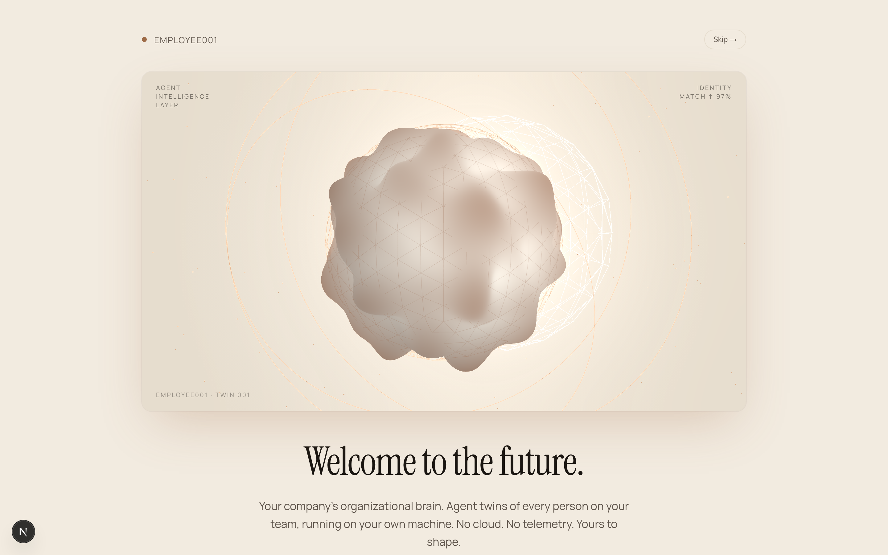
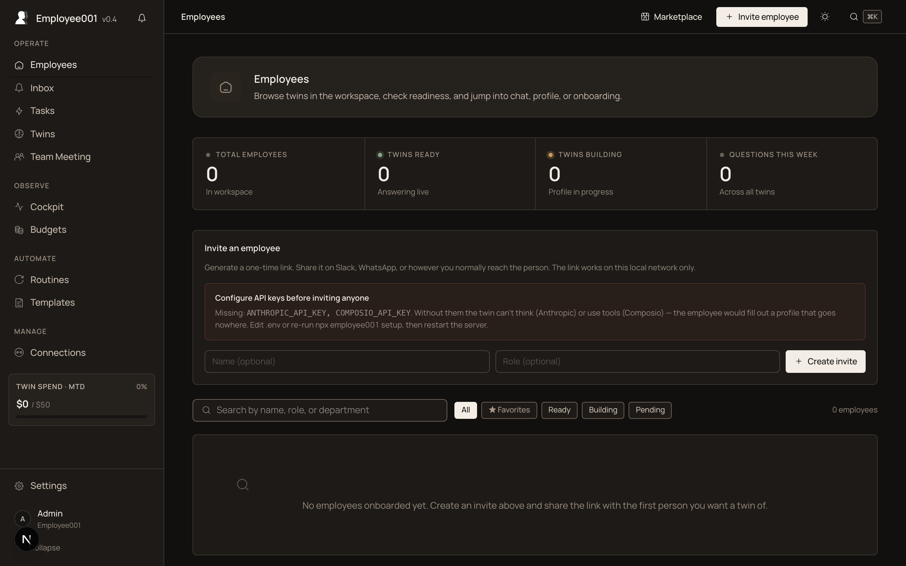
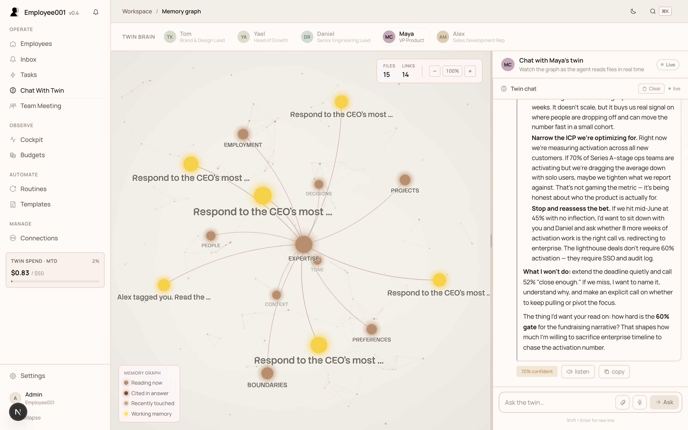
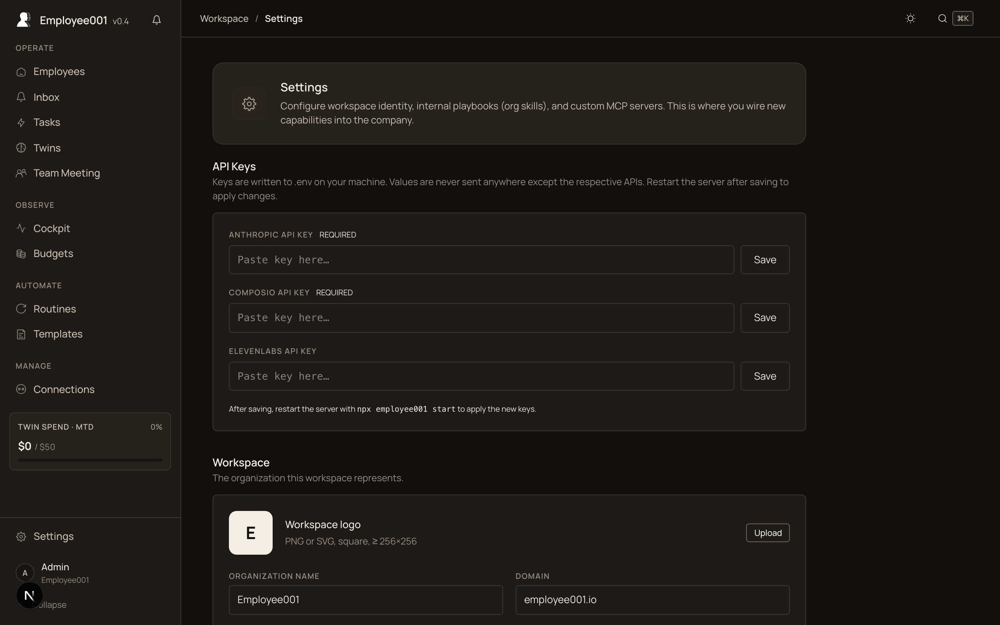
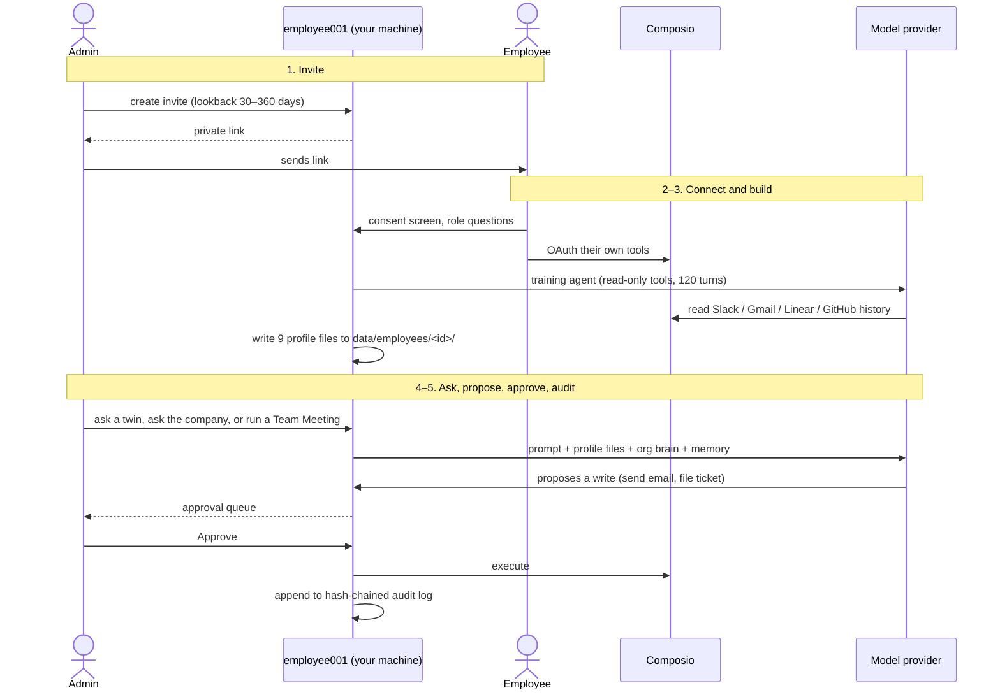
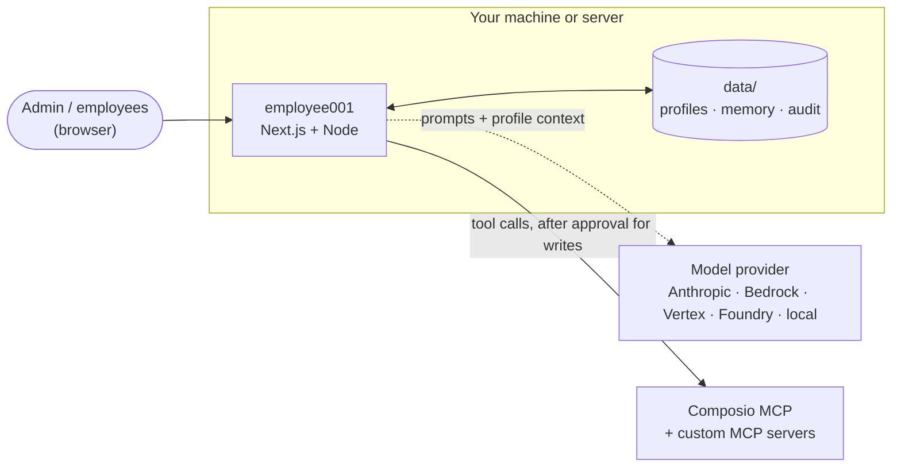

<div align="center">

# Employee001

### Your real team. Now with AI twins.

**Employee001 builds an AI twin of each employee from their own work: the expertise, decisions and tools they choose to connect.** Ask the twin of the person who knows, ask the whole company for one cited answer, or convene the right twins in a Team Meeting. External actions wait for a person's approval. Open source, self-hosted.

```bash
npx employee001 setup     # first-run wizard
npx employee001 start     # opens http://localhost:3000
```

[](https://www.npmjs.com/package/employee001)
[](https://www.npmjs.com/package/employee001)
[](https://github.com/dolevhayut/Employee001/actions/workflows/ci.yml)
[](https://opensource.org/licenses/MIT)
[](https://nodejs.org)
[](https://github.com/dolevhayut/Employee001/discussions)

[**Why**](#why-it-exists) · [**What's different**](#what-makes-it-different) · [**How it works**](#how-it-works) · [**Features**](#features-shipped-today) · [**Install**](#installation) · [**Privacy & security**](#privacy-and-security-boundaries) · [**Compare**](#how-it-compares) · [**Roadmap**](#cloud-and-roadmap)

</div>

<table>
  <tr>
    <td></td>
    <td></td>
  </tr>
  <tr>
    <td></td>
    <td></td>
  </tr>
</table>

## Why it exists

In a growing company, the answers live in a few people's heads and in threads scattered across Slack, email, tickets and code. Everyone else waits for those people, cross-team questions wait for a meeting, and context is at risk whenever someone is on leave or changes roles.

Search finds documents. A generic AI agent knows what a "Head of Sales" usually does. Neither knows what *your* colleague decided, why, and who else to pull in. Employee001 is built for that gap.

## What makes it different

**Twins of real, named people, not role templates.** A twin starts from one employee's own work history, from the tools they connect after a consent screen, and is written into nine Markdown files you can read and edit.

| | A generic role agent | An Employee001 twin |
|---|---|---|
| Starts from | A job title and a prompt | One named employee's connected work history |
| Knows | What the role usually does | What this person worked on, decided and why, who they work with, their boundaries |
| You can check it | Inside a system prompt | In `EXPERTISE.md`, `DECISIONS.md` and seven more plain files |
| When it's wrong | Rewrite the prompt | Fix the line; the person is still there to ask |

Twins are **not fine-tuned models** and they don't replace anyone. Each twin is its profile files plus its memory, run on Claude through the [Claude Agent SDK](https://docs.claude.com/en/api/agent-sdk/overview). (Employee001 also ships generic marketplace agents for roles you don't have a person for.)

## How it works

**Invite → employee-authorized connection → grounded twin → Ask or Team Meeting → approve actions.**

1. **Invite.** An admin creates a private invite link for a named employee and picks a lookback window of 30 to 360 days.
2. **The employee connects their work.** They open the link, review a consent screen (required scopes, plus opt-in scopes for acting on their behalf and for transcripts), answer a few role questions, and connect their tools (Slack, Gmail, Linear, GitHub, Calendar, Drive and more) through [Composio](https://composio.dev) OAuth. An admin can also start a connection from `/connections`.
3. **A grounded twin is written.** A training agent reads that history through a read-only gate (120-turn and $5 budget) and writes nine profile files: `CONTEXT`, `EXPERTISE`, `PROJECTS`, `PEOPLE`, `DECISIONS`, `PREFERENCES`, `TONE`, `BOUNDARIES`, `EMPLOYMENT`.
4. **Ask, or convene.** Ask one twin. Ask the company and get one answer with every claim cited. Or open a Team Meeting with the twins whose area it is.
5. **Approve.** When a twin wants to send an email, post in Slack or file a ticket, it stops in the approval queue by default. Every tool call is written to a hash-chained audit log.



## Features shipped today

Everything below is in the current npm release ([0.7.0](CHANGELOG.md)) unless marked otherwise.

**Ask and collaborate**
- **Ask a twin** (`/flow`): talk to one twin, see each source and tool it reaches for, or hand it a task.
- **Ask the company** (`/ask`): one question goes to the 1–3 twins whose area it is, the Org Brain and org-wide MCP systems, in parallel and read-only. One answer comes back with each claim cited. The combined answer needs direct Anthropic API access; otherwise you see each source's brief.
- **Team Meeting** (`/council`): selected or @mentioned twins take turns on a question, see the whole thread and can tag a colleague in. **Summarize & decide** turns it into a decision, owned actions and open questions. Export as Markdown.
- **Org Brain**: keyword search over every twin's profile files plus knowledge nodes an admin curates. Peers can read each other's profile files; each twin's memory stays private to it.

**Twins that keep context**
- **Memory**: per-twin episodic recall and distilled facts, stored locally, with a relevance gate. Semantic recall uses OpenAI embeddings only if you add `OPENAI_API_KEY`.
- **Knowledge uploads**: PDF and Word files become Markdown the twin reads on demand.
- **Editable profiles**: a split-pane editor over the nine files in `/profile`, with version history.
- **Hebrew**: twins converse, write and remember in Hebrew with right-to-left rendering. UI translation is partial.

**Work, with sign-off**
- **Approvals** for write actions and web fetches, with a sidebar badge and an inbox. Per-employee tool policies can turn a tool off or allow it without asking.
- **Slack**: a connected twin drafts answers to its @mentions and DMs; replies go through Approvals by default.
- **Email intake**: a twin drafts replies to incoming mail; sending goes through the approval gate.
- **Routines and autonomous shifts** (`/routines`, `/cockpit`) with per-run archives and a daily per-twin budget. They only run when Autonomy is switched on (off by default).
- **Voice**: listen to answers via ElevenLabs. Speaking a question in Ask is on `main`, not yet released.

**Platform**
- **MCP server**: ask your twins from Claude Code, Cursor and other MCP clients ([docs/mcp.md](./docs/mcp.md)).
- **Custom MCP servers** with Bearer auth or OAuth, from `/settings`.
- **Marketplace**: 14 generic role agents (SDR, DevOps, Writer, Analyst, CSM and more) that need no invite.
- **Backup**: `export` / `import` of the whole `data/` folder, optionally encrypted.

### Try the demo first

```bash
npx employee001 demo
```

Replays a recorded session with five invented twins in a temporary folder. No API keys, nothing written to your current directory. Add `--live` to run it against your own model provider.

## Installation

```bash
npx employee001 setup     # interactive first-run wizard: writes .env, creates data/
npx employee001 start     # starts the server and opens http://localhost:3000
```

Running `npx employee001` with no command prints help. `start` runs `setup` first if there's no `.env` in the current directory. Press <kbd>Ctrl</kbd>+<kbd>C</kbd> to stop.

The folder you run `setup` in is your install: it holds `.env` and `data/`. Run `start` from the same folder, or set `EMPLOYEE001_HOME=/path/to/install` to use it from anywhere.

### First run: if something goes wrong

- **"Port 3000 is already in use".** Another app (often a dev server) has it. Run `npx employee001 start --port 3001`, or change `PORT` in `.env`. The demo moves to the next free port by itself.
- **A twin answers with "Invalid API key".** Fix `ANTHROPIC_API_KEY` in `.env` (or run `npx employee001 setup` again) and restart. On Bedrock, Vertex AI or Foundry, check that provider's credentials on this machine.
- **"No .env found".** You're in a different folder from the one you set up. `cd` back to it, or set `EMPLOYEE001_HOME`.
- **The browser didn't open.** Open the URL printed in the terminal (`http://localhost:3000` by default).
- **Anything else.** `npx employee001 doctor` checks Node, `.env`, keys, port and the build. Employee001 is tested on Node 22 and 24 LTS.

> [!NOTE]
> **Requirements.** Node.js 22+. You need a model provider: an [Anthropic API key](https://console.anthropic.com), or your own Amazon Bedrock, Google Vertex AI, Azure AI Foundry, or a local Anthropic-compatible endpoint. Inviting employees and building their twins also needs a [Composio API key](https://app.composio.dev); marketplace agents work without it. No keys at all? `npx employee001 demo` runs a recorded meeting with five invented twins.

### Commands

| Command | What it does |
|---|---|
| `npx employee001 setup` | Interactive first-run wizard. Writes `.env`, creates `data/`. |
| `npx employee001 start` | Starts the local server and opens the browser. Flags: `--no-open`, `--port <n>`, `--strict` (no nonessential traffic). |
| `npx employee001 demo` | Try it with five invented twins and no keys. Flags: `--live`, `--keep`, `--port <n>`. |
| `npx employee001 doctor` | Health check: Node version, env, API keys, port, build. |
| `npx employee001 doctor --egress` | Lists every outside host your current config talks to, and what is sent. |
| `npx employee001 secure` | Moves plaintext `.env` secrets into your OS keychain. |
| `npx employee001 export <path>` | Snapshots `data/` to a tar.gz (excludes secrets). `--encrypt` adds a passphrase. |
| `npx employee001 import <path>` | Restores `data/` from a tar.gz. `--force` overwrites. |
| `npx employee001 mcp` | stdio bridge so Claude Code, Cursor and other MCP clients can use the running app. `--url <url>` / `--token <t>` for another endpoint (or `EMPLOYEE001_MCP_URL` / `EMPLOYEE001_MCP_TOKEN`). |
| `npx employee001 update` | Checks GitHub releases for a newer version. |
| `npx employee001 help` | Shows help. |

### Use from Claude Code / Cursor

Ask your twins from the editor while you code. Start Employee001 first (`npx employee001 start`).

**Claude Code plugin** (recommended). Adds `/employee001:ask-company`, `/employee001:ask-twin` and `/employee001:team-meeting`, and lets Claude check what the team decided before it builds:

```text
/plugin install employee001 --marketplace dolevhayut/Employee001
```

**Claude Code, MCP tools only:**

```bash
claude mcp add employee001 -- npx -y employee001 mcp
```

**Cursor**: add this to `.cursor/mcp.json` (Claude Desktop and other stdio clients take the same block):

```json
{ "mcpServers": { "employee001": { "command": "npx", "args": ["-y", "employee001", "mcp"] } } }
```

The default connection is your local app at `http://127.0.0.1:3000/api/mcp`. For another port or a remote instance, set `EMPLOYEE001_MCP_URL` and, once sign-in is on, `EMPLOYEE001_MCP_TOKEN` in the client's `env` (or pass `--url` / `--token`). Tools: `list_twins`, `get_twin_profile`, `search_org_brain`, `list_pending_approvals`, `list_team_meetings`, `get_team_meeting`, `ask_twin` (answer-only, rate- and cost-limited). Plugin guide: [plugins/claude-code](./plugins/claude-code/README.md). Full reference: [docs/mcp.md](./docs/mcp.md).

## Privacy and security boundaries

Four different things, stated separately. The full table is in [SECURITY.md](SECURITY.md#what-leaves-your-machine); `npx employee001 doctor --egress` prints the hosts for *your* configuration.

| Boundary | What | Notes |
|---|---|---|
| **Stored on your machine** | Profiles, knowledge files, memory, chat history, meetings, approvals, audit log, settings | Files under `./data/`. No database, no Employee001 account. Protect the folder with filesystem permissions. |
| **Sent to your model provider** | Prompts and the profile context a twin needs | Anthropic API, or your own Bedrock / Vertex AI / Azure AI Foundry / local endpoint for twin runs and twin building. Meeting summaries, Ask's combined answer, memory rerank and knowledge proposals call the Anthropic API directly (disabled in cloud-provider mode unless `EMPLOYEE001_ALLOW_DIRECT_ANTHROPIC=1`). The provider's own terms apply. |
| **Sent to tools you connect** | Tool calls and OAuth | Composio for employee-connected apps, plus any custom MCP server. `WebSearch` queries go out without approval; `WebFetch` waits for it. Optional: OpenAI (memory embeddings), ElevenLabs (text-to-speech, and microphone audio for speech-to-text). |
| **Telemetry** | Off by default | Opt-in only, anonymous aggregate counts (version, OS, number of twins, meetings, approvals). No endpoint is configured out of the box. |

### What twins can and can't do

- **Approval gate.** Write actions (send, post, create, update) and every `WebFetch` pause in the approval queue. Read-only calls (list, search, fetch messages, read PRs) run on their own. Deletes and payments are always blocked. Unanswered approvals expire as a deny: 10 minutes in chat, 6 hours for background work.
- **Admin overrides are explicit.** A per-employee policy can allow a tool without asking, and an admin can opt a twin into direct Slack answers (action requests and external shared channels still need approval). Every such call is still audited.
- **No shell.** `Bash`, `NotebookEdit`, `EnterWorktree` and `ExitWorktree` are hard-disallowed, enforced both by the SDK's `disallowedTools` and a `PreToolUse` hook.
- **Scoped reads and writes.** A twin reads its own folder, colleagues' nine profile files, `org-brain/` and `org-skills/`. Other twins' memory and chats, invites, the audit log and settings are blocked. `Write` is sandboxed to `data/scratch/<employee-id>/`.
- **Audit trail.** Every executed tool call is appended to `data/audit.jsonl` with run id, employee id, tool, input and verdict. Rows are SHA-256 hash-chained and verifiable (`/api/audit/verify`); browse them at `/audit`.
- **Deletion.** Deleting a twin, or revoking its consent from the profile page, purges its profile, knowledge, memory, chats, runs, routines and pending approvals, and deletes its Composio connections. Audit rows keep time, tool and outcome with the input and name erased.
- **Web citations.** After `WebSearch` or `WebFetch`, a hook tells the model to cite the URL and fetch date.

<details>
<summary><b>Permissions per run type</b></summary>

| Run type | Built-in tools | External tools |
|---|---|---|
| **Twin chat** | `Read`, `Glob`, `Grep`, `Write`¹, `WebSearch`, `WebFetch`, `Task`², `TodoWrite`, `AskUserQuestion` | Composio³ |
| **Twin training** | `Read`, `Write`¹, `Glob`, `Grep`, `TodoWrite` | Composio³ (read-only signal) |
| **Scheduled routines** | `TodoWrite` | Composio³ |
| **Org-brain summarisation** | none | none |

¹ Sandboxed to `data/scratch/<employee-id>/`; path traversal is rejected.
² Spawns a restricted sub-agent: a web-researcher (`WebSearch` + `WebFetch`) or a brain-explorer (`Read` + `Glob` + `Grep`), with the same hard-disallow list.
³ External-effect tools. Every call that changes something hits the approval gate; read-only calls run without prompting.

**Models.** `claude-sonnet-5-5` by default, `claude-sonnet-5` as fallback; switch to Opus per message in the chat UI. Source of truth: [`src/lib/sdk-defaults.ts`](src/lib/sdk-defaults.ts).

</details>

### Where your data lives

```
./
├── .env                  # your API keys (chmod 600; `secure` moves them to the OS keychain)
└── data/
    ├── employees/<id>/   # 9 Markdown profile files + knowledge/ per twin
    ├── org-brain/        # shared knowledge nodes (Org Brain)
    ├── org/              # org settings: skills, Slack triggers, custom MCP servers
    ├── memory/<id>/      # per-twin memory: episodes and distilled facts
    ├── meetings/         # Team Meeting transcripts
    ├── audit.jsonl       # every tool call, hash-chained
    ├── routines.json     # scheduled work
    └── shifts/<runId>/   # autonomous-shift archives
```

> [!TIP]
> `npx employee001 export ~/Desktop/e001-backup.tar.gz` snapshots everything except secrets. `npx employee001 import <archive>` restores on a fresh install.

### Network exposure

The server binds to `127.0.0.1` by default, so only this machine can reach it. To share it on a LAN (for example a Mac mini in the office):

```bash
EMPLOYEE001_BIND=0.0.0.0 npx employee001 start
```

Off loopback, every request must carry the shared-secret token `setup` generates (`EMPLOYEE001_TOKEN`); `start` prints the access URL, and each device gets a 30-day httpOnly cookie. Invite links bypass the gate only for `/join`, `/onboarding` and `/api/invites/<token>`.

> [!WARNING]
> The app is not hardened for the public internet. Use a firewall or [Tailscale](https://tailscale.com). **Don't put this on a port-forwarded box.**

You host Employee001, so it runs inside your environment and your compliance scope. We make no SOC 2 or ISO claims. Report vulnerabilities privately, as described in [SECURITY.md](SECURITY.md).

## How it compares

Last reviewed **2026-10-21**, from each project's public pages. Both are good open-source projects that overlap with Employee001; the difference is where an agent comes from.

| | [Paperclip](https://github.com/paperclipai/paperclip) | [Cabinet](https://github.com/cabinetai/cabinet) | **Employee001** |
|---|---|---|---|
| Focus | Managing a company of AI agents: org chart, goals, tickets, budgets, board governance | An AI workspace: git-versioned Markdown knowledge base plus an AI team | Making what your real people know askable |
| What an agent represents | An AI employee with a title, role, instructions and budget; people can sit in the same org chart | An agent persona from about 20 templates (CEO, CTO, Marketer, SDR...) | **One named employee, built from the work history they connect** |
| Runtime | Bring your own (Claude Code, Codex, Cursor, Gemini CLI, HTTP/shell...) | Several runtimes (Claude Code, Codex, OpenAI, Gemini, local models...) | Claude via the Claude Agent SDK |
| Several agents at once | Delegation along the org chart, ticket threads | Channels where agents and people chat; @mention an agent | Team Meeting ending in a decision with owners; Ask the company |
| External actions | Board approvals, per-tool Allowed / Ask first / Off, review stages; v2026.1001.0 notes say execution harnesses default to full auto unless a restrictive mode is set | Dispatched work waits in a human approval queue | Writes and web fetches wait for approval by default; hash-chained audit log |
| Shared ground | MIT, self-hosted, routines, MCP + Composio, audit trail, cloud waitlist | MIT, local, files on disk, MCP, scheduled jobs, cloud waitlist | MIT, self-hosted, routines, MCP + Composio, cloud waitlist |

Sources: [paperclipai/paperclip](https://github.com/paperclipai/paperclip), [docs.paperclip.ing](https://docs.paperclip.ing), [Paperclip v2026.1001.0](https://github.com/paperclipai/paperclip/releases/tag/v2026.1001.0), [cabinetai/cabinet](https://github.com/cabinetai/cabinet), [runcabinet.com](https://runcabinet.com), [docs.runcabinet.com](https://docs.runcabinet.com/cabinet/agents/). Spotted something out of date? [Open an issue](https://github.com/dolevhayut/Employee001/issues) and we'll fix the table.

## Cloud and roadmap

**Employee001 Cloud is not available.** A managed edition is planned as a separate paid service, not a feature gate on this code; join the waitlist at [employee001.com](https://employee001.com). Everything in this repo stays MIT and self-hostable.

**Your own cloud instance, today.** Deploy a single-tenant instance to an always-on host you control: one org = one container + one persistent volume + its own secrets. The storage model is unchanged (`data/` on a mounted volume), and migration uses the same `export` / `import`. Recommended: [Fly.io](https://fly.io). Not Vercel or other serverless hosts, whose filesystems are ephemeral. Runbook: [docs/DEPLOY-CLOUD.md](./docs/DEPLOY-CLOUD.md). Keep it private (Fly private networking or Tailscale) until the access gate is hardened.

**In progress on `main` (not in a release yet):** consent deny-by-default for twins without a consent record, an AI-disclosure prefix on Slack and email a twin sends, an admin allowlist for Slack auto-replies, and voice input in Ask.

**Planned:** SSO, roles and MFA; full UI internationalization; multi-admin / multi-tenant; a desktop wrapper for non-technical admins.

## Architecture

- [Next.js 16](https://nextjs.org) (App Router, standalone output) and React 19, TypeScript strict
- [Claude Agent SDK](https://docs.claude.com/en/api/agent-sdk/overview) for every twin run: streaming, sub-agents, permission hooks, MCP
- [Composio MCP](https://composio.dev) for employee-authorized integrations, plus custom MCP servers
- JSON, JSONL and Markdown on disk under `data/`; no database
- Published to npm as [`employee001`](https://www.npmjs.com/package/employee001); releases carry [build provenance](SECURITY.md#verifying-a-release)



## Open source, paid help

100% of the code here is MIT. Paid services, not paid features: professional onboarding (we install it, connect your tools, build the first twins with your team), SLA support and custom integrations. [Open a discussion](https://github.com/dolevhayut/Employee001/discussions) or email <a href="mailto:office@bulldog-adv.com">office@bulldog-adv.com</a>.

## Contributing

PRs welcome. See [CONTRIBUTING.md](./CONTRIBUTING.md) for setup and the rules of the road, and [SECURITY.md](SECURITY.md) for reporting a vulnerability. Maintainers: [RELEASING.md](./RELEASING.md) describes the tag-driven publish flow.

## License

MIT © [Dolev Hayut](https://github.com/dolevhayut)

<div align="center">

**If Employee001 is useful to you, [star the repo](https://github.com/dolevhayut/Employee001). It helps others find it.**

</div>
