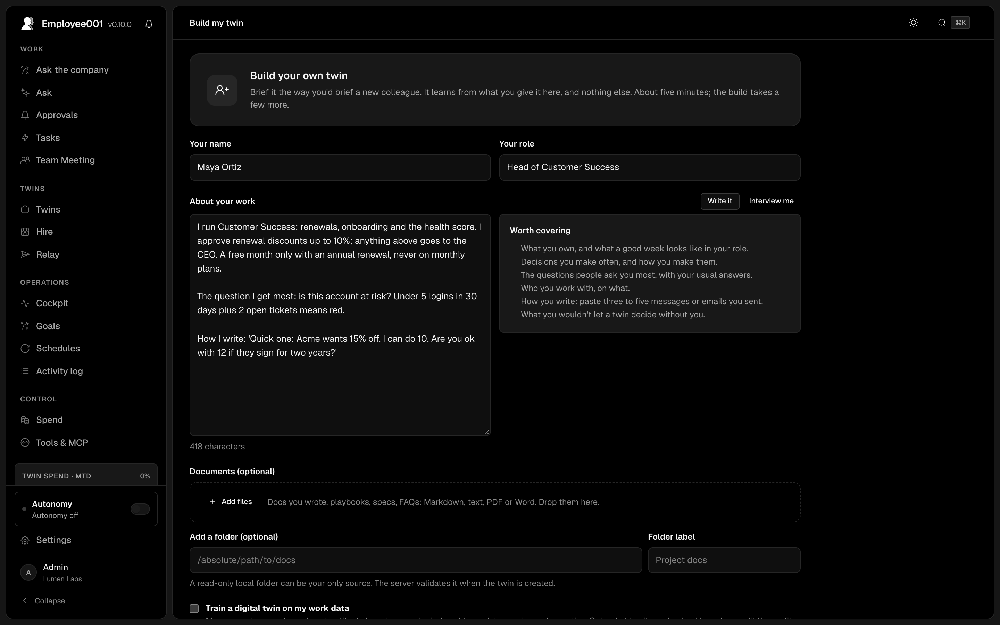
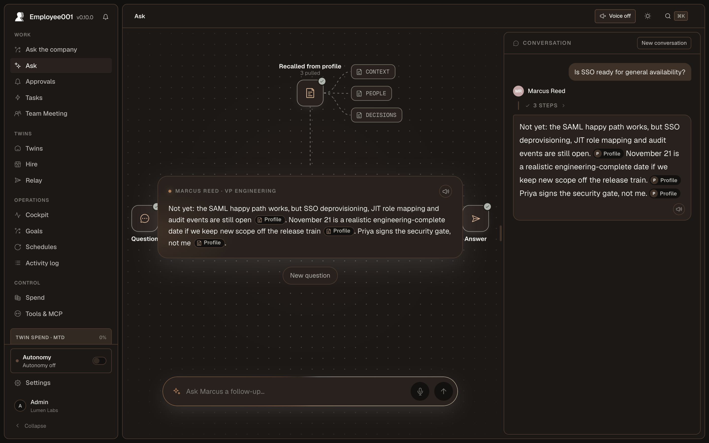
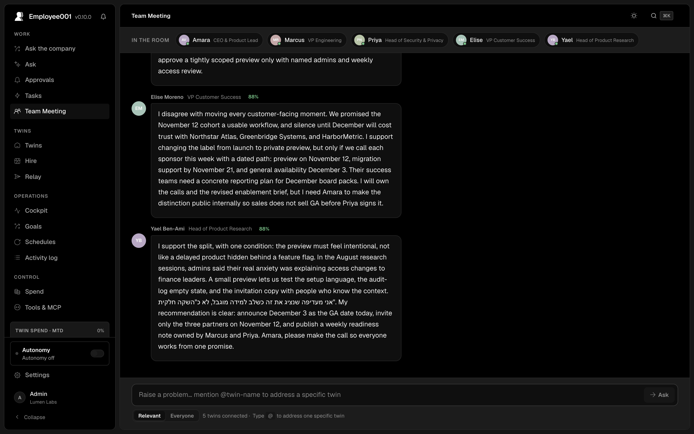
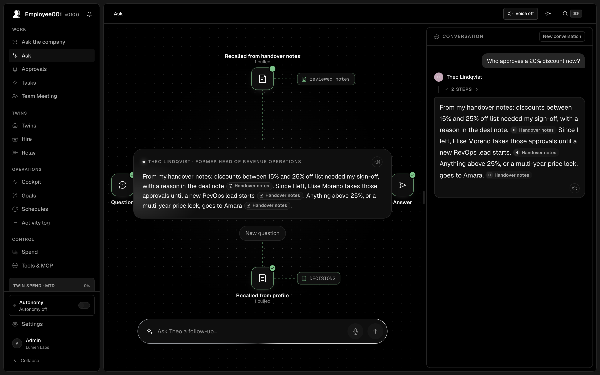
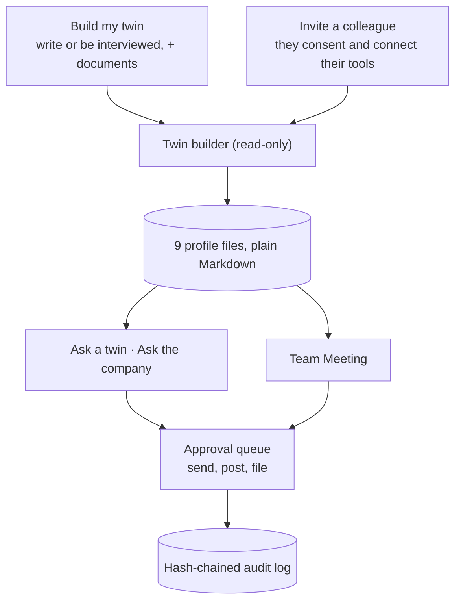
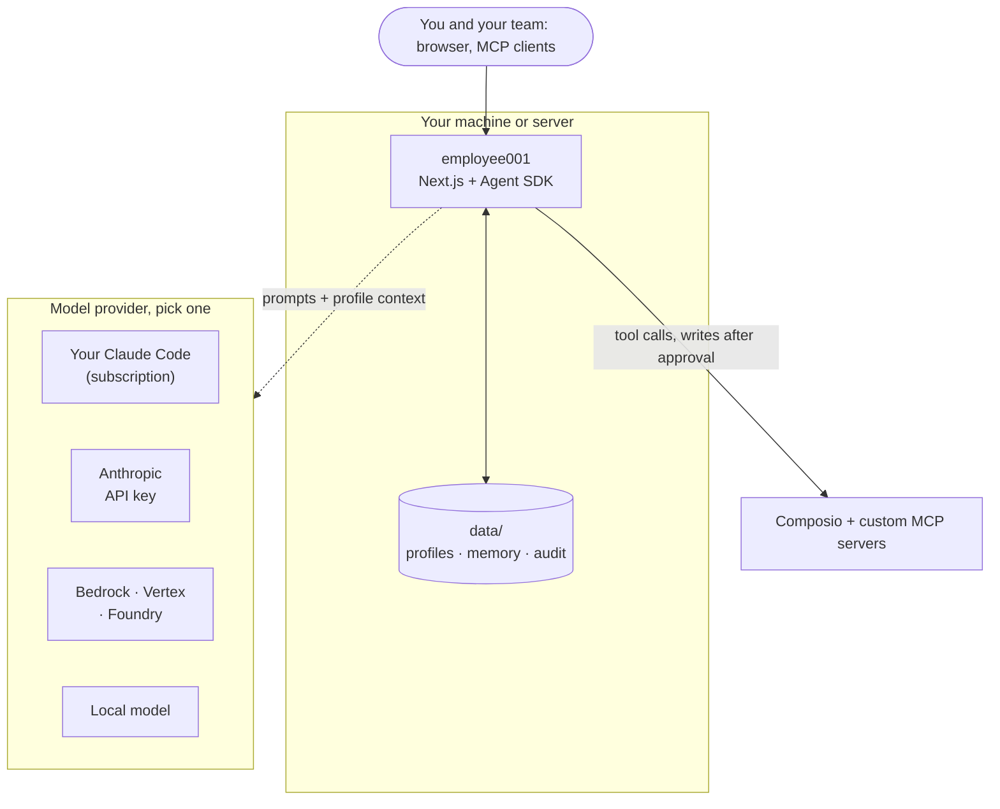

<div align="center">

# Employee001

### Your real team. Now with AI twins.

**Employee001 builds an AI twin of each employee from their own work: what they know, how they decide, and the tools they choose to connect.** Ask the twin of the person who knows, ask the whole company for one cited answer, or convene the right twins in a Team Meeting. External actions wait for a person's approval. Open source, self-hosted.

**Consent first: no twin is trained, given a person's tools or allowed to act for them until that person has recorded their consent.**

**Every install is also your organization's own MCP server**, so your team can ask the twins from the agents they already use: Claude Code, Codex, Cursor, Claude Desktop.

```bash
npx employee001     # first run: a short setup, then it opens http://localhost:3000
```

Signed in to Claude Code? Your Claude subscription runs the twins, no API key needed. Subscription mode covers one person.

<table>
  <tr>
    <td width="33%" valign="top"><b>1. Run it</b><br /><code>npx employee001</code><br /><sub>A short setup, then it opens http://localhost:3000.</sub></td>
    <td width="33%" valign="top"><b>2. Build my twin</b><br /><br /><sub>Write about your work or be interviewed.</sub></td>
    <td width="33%" valign="top"><b>3. Get a first answer</b><br /><br /><sub>Ask your twin. The answer comes with its sources.</sub></td>
  </tr>
</table>

Claude subscription covers one person. For a team, use an Anthropic API key, a cloud provider or a local model.

[](https://www.npmjs.com/package/employee001)
[](https://www.npmjs.com/package/employee001)
[](https://github.com/dolevhayut/Employee001/actions/workflows/ci.yml)
[](https://opensource.org/licenses/MIT)
[](https://nodejs.org)
[](https://github.com/dolevhayut/Employee001/discussions)

[**Get started**](#get-started-in-five-minutes) · [**Why**](#why-it-exists) · [**How it works**](#how-it-works) · [**Features**](#features-shipped-today) · [**Install**](#installation) · [**MCP**](#your-twins-inside-every-agent-mcp) · [**Privacy & security**](#privacy-and-security-boundaries) · [**Compare**](#how-it-compares) · [**Roadmap**](#cloud-and-roadmap)

</div>

<p align="center">
  <br />
  <sub>Ask a twin. The answer, the sources it used, and its run drawn as a graph.</sub>
</p>

<table>
  <tr>
    <td width="33%" align="center" valign="top"><br /><sub>Build my twin: write or be interviewed</sub></td>
    <td width="33%" align="center" valign="top"><br /><sub>Team Meeting</sub></td>
    <td width="33%" align="center" valign="top"><br /><sub>Relay: a former employee's twin</sub></td>
  </tr>
</table>

## Get started in five minutes

1. **Run it.** `npx employee001`. Setup finds your signed-in Claude Code and offers your Claude subscription, with no API key; it covers one person. Otherwise it asks for an Anthropic API key, your cloud provider (Bedrock, Vertex AI, Foundry) or a local model.
2. **Build your own twin.** Open **Build my twin**, first on the Launchpad. Write about your work or answer a short interview, add documents if you like, and agree. The builder writes the nine profile files while you watch.
3. **Ask it.** Open **Ask**, pick your twin, and ask it what people usually ask you.

No keys yet? `npx employee001 demo` opens an invented company with six twins and replays recorded answers. [More on the demo](#try-the-demo).

## Why it exists

In a growing company, the answers live in a few people's heads and in threads scattered across Slack, email, tickets and code. Everyone else waits for those people. Cross-team questions wait for a meeting. Context is at risk whenever someone is on leave, changes roles or leaves.

Search finds documents. A generic AI agent knows what a "Head of Sales" usually does. Neither knows what *your* colleague decided, why, and who else to pull in. Employee001 is built for that gap.

| | A generic role agent | An Employee001 twin |
|---|---|---|
| Starts from | A job title and a prompt | One named person's own account of their work, their documents and, if they choose, their connected tools |
| Knows | What the role usually does | What this person worked on, decided and why, who they work with, their boundaries |
| You can check it | Inside a system prompt | In `EXPERTISE.md`, `DECISIONS.md` and seven more plain files |
| When it's wrong | Rewrite the prompt | Fix the line; the person is still there to ask |

Twins are **not fine-tuned models** and they don't replace anyone. Each twin is its profile files plus its memory, run on Claude through the [Claude Agent SDK](https://docs.claude.com/en/api/agent-sdk/overview). Employee001 also ships generic marketplace agents for roles you don't have a person for.

## How it works

A twin can be built two ways. Both end in the same nine Markdown files: `CONTEXT`, `EXPERTISE`, `PROJECTS`, `PEOPLE`, `DECISIONS`, `PREFERENCES`, `TONE`, `BOUNDARIES`, `EMPLOYMENT`.

**1. Build my twin (you).** The person running Employee001 briefs their own twin at `/build-my-twin`. Write a few paragraphs about your work (what you own, how you decide, what people ask you, a few messages you wrote), or choose **Interview me** and answer about eight questions, one at a time. Add documents if you like (PDF, Word, Markdown, text, CSV, JSON). The builder writes the profile files from that material and says where it falls short instead of making things up. No invite, no Composio, no OAuth.

**2. Invite a colleague (them).** An admin creates a private invite link and picks a lookback window of 30 to 360 days. The colleague reviews a consent screen, answers a few role questions and connects their own tools (Slack, Gmail, Linear, GitHub, Calendar, Drive and more) through [Composio](https://composio.dev). A builder agent reads that history through a read-only gate (120 turns, $5 budget) and writes their profile files. Invites need an API key or a cloud provider, plus a Composio key; Claude subscription mode is for one person.

**Then, for every twin:**
- **Ask** one twin, **Ask the company** for one answer with every claim cited, or open a **Team Meeting** with the twins whose area it is.
- When a twin wants to send an email, post in Slack or file a ticket, it stops in the **approval queue**.
- Every tool call is written to a **hash-chained audit log**.



## Features shipped today

Everything below is in the current npm release ([0.10.0](CHANGELOG.md)).

**Build twins**
- **Build my twin** (`/build-my-twin`): brief your own twin by writing or by **Interview me**, with optional documents. No tools to connect.
- **Invite a colleague**: they consent, connect their own tools, and their twin is built from that history. Connected tools also deepen a self-built twin.
- **Editable profiles** (`/profile`): a split-pane editor over the nine files, with version history.
- **Knowledge uploads**: PDF and Word files become Markdown the twin reads on demand.
- **Local folders**: point a twin at up to five folders on your machine and it answers from your real files, read-only, with nothing uploaded. `.env` files, keys, `.git` and `node_modules` are never read, and every add and remove is audited. The files it reads go to your model provider.

**Ask and collaborate**
- **Ask** (`/ask`): talk to one twin, see each source and tool it reaches for, or hand it a task. Your conversations are saved per person; each person sees only their own.
- **Ask the company** (`/brain`): one question goes to the 1 to 3 twins whose area it is, the Org Brain and org-wide MCP systems, in parallel and read-only. One answer comes back with each claim cited, written through whichever model provider you use.
- **Team Meeting** (`/council`): selected or @mentioned twins take turns, see the whole thread and can tag a colleague in. **Summarize & decide** gives a decision, owned actions and open questions. Export as Markdown.
- **Org Brain**: search over every twin's profile files plus knowledge an admin curates. Peers can read each other's profile files; each twin's memory stays private to it.
- **Voice**: talk to a twin in Ask. Live transcription, the answer spoken sentence by sentence in the twin's voice, and you can talk over it (ElevenLabs; off in EU mode).

**Twins that keep context**
- **Memory**: per-twin episodes and distilled facts, stored locally. Semantic recall uses embeddings only if you add `OPENAI_API_KEY` or `EMBEDDINGS_BASE_URL`.
- **Relay** (`/handover`): when someone leaves, a short interview asks what their twin's profile is missing. With their consent the twin stays as a read-only "Former <role>" that everyone can keep asking. Admins can download the handover notes.
- **Hebrew**: twins converse, write and remember in Hebrew with right-to-left rendering. Hebrew UI is in beta.

**Work, with sign-off**
- **Approvals** for write actions and web fetches, with an inbox and a sidebar badge. Per-employee tool policies can turn a tool off or allow it without asking.
- **Slack and email**: a connected twin drafts replies; sending goes through Approvals. Everything a twin sends starts with "🤖 AI twin of &lt;name&gt;:".
- **Routines and autonomous shifts** (`/routines`, `/cockpit`) with per-run archives and a daily per-twin budget. They run only when Autonomy is on (off by default).

**Platform**
- **Model providers**: your Claude subscription through a signed-in Claude Code (one person, no API key), an Anthropic API key, Amazon Bedrock, Google Vertex AI, Azure AI Foundry, or a local Anthropic-compatible model.
- **Your org's own MCP server**: anyone on the team can ask the twins from Claude Code, Codex, Cursor and other MCP clients ([below](#your-twins-inside-every-agent-mcp)).
- **Custom MCP servers** with Bearer auth or OAuth, from Settings.
- **Accounts and roles**: owner, admin, approver, member, employee. TOTP two-factor and OpenID Connect single sign-on.
- **Opt-in OS sandbox**: `EMPLOYEE001_SANDBOX=1` wraps each twin process in Anthropic's Sandbox Runtime for an OS-level file and network boundary. It fails closed. Tested on macOS.
- **Marketplace**: 14 generic role agents (SDR, DevOps, Writer, Analyst, CSM and more) that need no person behind them.
- **Backup**: `export` / `import` of the whole `data/` folder, optionally encrypted.

### Try the demo

```bash
npx employee001 demo
```

Opens a made-up company, Lumen Labs, in a temporary folder: six invented twins, one of them a former employee. No API keys and no model calls. Everything is replayed from recordings, and nothing is written to your current directory.

- **Team Meeting** opens first and replays five twins debating a launch date.
- **Relay → Former employees** has Theo, a Head of Revenue Operations who has left. His twin is read-only and answers only from his profile and his approved handover notes.
- **Ask** suggests recorded questions. Ask Theo who approves a 20% discount now and he answers from his notes; ask about this quarter's churn and he says he doesn't know. Turn on **Voice on** to hear each answer.

Any other question gets a pointer to `--live`, which runs the demo on your own model provider. The microphone needs an ElevenLabs key.

## Installation

```bash
npx employee001           # starts the server and opens http://localhost:3000
```

With no command it runs `start`, which runs `setup` first if there's no `.env` in the current folder. Setup asks only what a first answer needs and takes the next free port if 3000 is busy. Add Composio, ElevenLabs or OpenAI keys later from Settings. Press <kbd>Ctrl</kbd>+<kbd>C</kbd> to stop.

The folder you run `setup` in is your install: it holds `.env` and `data/`. Run `start` from the same folder, or set `EMPLOYEE001_HOME=/path/to/install` to use it from anywhere.

### First run: if something goes wrong

- **A twin says the key is invalid, or Claude Code is signed out.** Fix the key in `.env`, sign in to Claude Code again, or run `npx employee001 setup`, then restart. On Bedrock, Vertex AI or Foundry, check that provider's credentials on this machine.
- **"No .env found".** You're in a different folder from the one you set up. `cd` back to it, or set `EMPLOYEE001_HOME`.
- **The browser didn't open.** Open the URL printed in the terminal.
- **Anything else.** `npx employee001 doctor` checks Node, `.env`, keys, Claude Code sign-in, port and the build. Tested on Node 22 and 24 LTS.

> [!NOTE]
> **Requirements.** Node.js 22+ and one model provider: your Claude subscription through a signed-in [Claude Code](https://code.claude.com) on the same machine (no API key, for you alone), an [Anthropic API key](https://console.anthropic.com), Amazon Bedrock, Google Vertex AI, Azure AI Foundry, or a local Anthropic-compatible endpoint. Inviting colleagues also needs a [Composio API key](https://app.composio.dev) and a provider other than the Claude subscription. Building your own twin and the marketplace agents need neither.

### Commands

| Command | What it does |
|---|---|
| `npx employee001 setup` | First-run wizard. Writes `.env`, creates `data/`. |
| `npx employee001 start` | Starts the local server and opens the browser. Flags: `--no-open`, `--port <n>`, `--strict` (no nonessential traffic). |
| `npx employee001 demo` | Six invented twins (one a former employee), no keys. Flags: `--live`, `--keep`, `--port <n>`. |
| `npx employee001 doctor` | Health check: Node, env, keys, Claude Code, port, build. `--egress` lists every outside host your config talks to and what is sent. |
| `npx employee001 secure` | Moves plaintext `.env` secrets into your OS keychain. |
| `npx employee001 export <path>` | Snapshots `data/` to a tar.gz (excludes secrets). `--encrypt` adds a passphrase. |
| `npx employee001 import <path>` | Restores `data/` from a tar.gz. `--force` overwrites. |
| `npx employee001 audit verify [file]` | Verifies the audit log's hash chain. |
| `npx employee001 mcp` | stdio bridge for MCP clients. `--url <url>` / `--token <t>` for another endpoint (or `EMPLOYEE001_MCP_URL` / `EMPLOYEE001_MCP_TOKEN`). |
| `npx employee001 update` | Checks GitHub releases for a newer version. |
| `npx employee001 help` | Lists the commands. |

### Your twins, inside every agent (MCP)

Every install includes an MCP server. It belongs to your organization: it runs inside your installation, answers from your twins and your org brain, and is not published anywhere. Each person connects their own agent to it, like any MCP tool. So a developer in Claude Code checks what product decided before building, an engineer in Codex asks the sales twin what a customer requires, and a support lead in Claude Desktop asks who owns a migration.

Start Employee001 first (`npx employee001 start`), then connect a client. The **Claude Code plugin** is the easiest. It adds `/employee001:ask-company`, `/employee001:ask-twin` and `/employee001:team-meeting`:

```text
/plugin install employee001 --marketplace dolevhayut/Employee001
```

**Claude Code, MCP tools only:**

```bash
claude mcp add --transport http employee001 http://127.0.0.1:3000/api/mcp
```

**Codex:**

```bash
codex mcp add employee001 --url http://127.0.0.1:3000/api/mcp
```

**Cursor** (`.cursor/mcp.json`):

```json
{ "mcpServers": { "employee001": { "url": "http://127.0.0.1:3000/api/mcp" } } }
```

**Claude Desktop and other clients that launch a local command** use the stdio bridge:

```json
{ "mcpServers": { "employee001": { "command": "npx", "args": ["-y", "employee001", "mcp"] } } }
```

**Teammates on other machines.** If Employee001 runs on a shared server, each person points their client at its URL and sends the instance's MCP token (`EMPLOYEE001_MCP_TOKEN`, kept in their own environment, never in a committed file):

```bash
claude mcp add --transport http employee001 https://e001.example.com/api/mcp --header "Authorization: Bearer $EMPLOYEE001_MCP_TOKEN"
codex mcp add employee001 --url https://e001.example.com/api/mcp --bearer-token-env-var EMPLOYEE001_MCP_TOKEN
```

**What an agent can do.** Read: `list_twins`, `get_twin_profile`, `search_org_brain`, `list_pending_approvals`, `list_team_meetings`, `get_team_meeting`. Ask: `ask_twin`, answer-only, rate- and cost-limited. Agents get member access: no settings, no approvals, no external actions. Full reference: [docs/mcp.md](./docs/mcp.md). Plugin guide: [plugins/claude-code](./plugins/claude-code/README.md).

## Privacy and security boundaries

Four different things, stated separately. The full list of subprocessors is in [SECURITY.md](SECURITY.md#what-leaves-your-machine); `npx employee001 doctor --egress` prints the hosts for *your* configuration.

| Boundary | What | Notes |
|---|---|---|
| **Stored on your machine** | Profiles, knowledge files, memory, chat history, meetings, approvals, audit log, accounts, settings | Files under `./data/`. No database, no Employee001 account. Protect the folder with filesystem permissions. |
| **Sent to your model provider** | Prompts and the profile context a twin needs | Your Claude Code (Claude subscription), the Anthropic API, or your own Bedrock / Vertex AI / Foundry / local endpoint. Meeting summaries, memory rerank and knowledge proposals call the Anthropic API directly, and are off on other providers unless `EMPLOYEE001_ALLOW_DIRECT_ANTHROPIC=1`. The provider's own terms apply. |
| **Sent to tools you connect** | Tool calls and OAuth | Composio for employee-connected apps, plus any custom MCP server. Optional: OpenAI (memory embeddings), ElevenLabs (voice, including microphone audio). |
| **Telemetry** | Off by default | Opt-in only, anonymous aggregate counts. No endpoint is configured out of the box. |

### What twins can and can't do

- **Consent first.** A twin whose person hasn't recorded consent can't be trained, gets none of their tools and can't act for them.
- **Approval gate.** Write actions (send, post, create, update) and every `WebFetch` wait for an approver. Reads that leave the machine ask unless an admin allowlisted the source. Deletes and payments are always blocked. Unanswered approvals expire as a deny: 10 minutes in chat, 6 hours for background work.
- **No shell.** `Bash`, `NotebookEdit`, `EnterWorktree` and `ExitWorktree` are hard-disallowed, by the SDK's `disallowedTools` and a `PreToolUse` hook.
- **Scoped reads and writes.** A twin reads its own folder, colleagues' nine profile files, `org-brain/` and `org-skills/`. Other twins' memory and chats, invites, the audit log and settings are blocked. `Write` is limited to `data/scratch/<employee-id>/`.
- **Optional OS sandbox.** `EMPLOYEE001_SANDBOX=1` adds a second, OS-level boundary around the model process. macOS needs `ripgrep`; Linux also needs bubblewrap and socat. See [SECURITY.md](SECURITY.md).
- **Audit trail.** Every executed tool call is appended to `data/audit.jsonl` with run id, employee id, tool, input, verdict and who approved. Rows are SHA-256 hash-chained; verify with `npx employee001 audit verify` and browse at `/audit`.
- **Deletion.** Deleting a twin, or revoking consent, purges its profile, knowledge, memory, chats, runs, routines and pending approvals, and deletes its Composio connections.

<details>
<summary><b>Permissions per run type</b></summary>

| Run type | Built-in tools | External tools |
|---|---|---|
| **Twin chat** | `Read`, `Glob`, `Grep`, `Write`¹, `WebSearch`, `WebFetch`, `Task`², `TodoWrite`, `AskUserQuestion` | Composio³ |
| **Twin training** | `Read`, `Write`¹, `Glob`, `Grep`, `TodoWrite` | Composio³ (read-only signal) |
| **Scheduled routines** | `TodoWrite` | Composio³ |
| **Org-brain summarisation** | none | none |

¹ Limited to `data/scratch/<employee-id>/`; path traversal is rejected. Only the twin builder writes profile files.
² Spawns a restricted sub-agent: a web-researcher (`WebSearch` + `WebFetch`) or a brain-explorer (`Read` + `Glob` + `Grep`), with the same hard-disallow list.
³ External-effect tools. Every call that changes something hits the approval gate.

**Models.** `claude-sonnet-5-5` by default, `claude-sonnet-5` as fallback; switch to Opus per message in the chat UI. Source of truth: [`src/lib/sdk-defaults.ts`](src/lib/sdk-defaults.ts).

</details>

### Where your data lives

```
./
├── .env                  # your keys (chmod 600; `secure` moves them to the OS keychain)
└── data/
    ├── employees/<id>/   # 9 Markdown profile files + knowledge/ per twin
    ├── org-brain/        # shared knowledge (Org Brain)
    ├── org/              # org settings: skills, Slack triggers, custom MCP servers
    ├── memory/<id>/      # per-twin memory: episodes and distilled facts
    ├── meetings/         # Team Meeting transcripts
    ├── audit.jsonl       # every tool call, hash-chained
    ├── routines.json     # scheduled work
    └── shifts/<runId>/   # autonomous-shift archives
```

### Network exposure

The server binds to `127.0.0.1` by default, so only this machine can reach it. To share it on a LAN (for example a Mac mini in the office):

```bash
EMPLOYEE001_BIND=0.0.0.0 npx employee001 start
```

Off loopback, the token `setup` generates (`EMPLOYEE001_TOKEN`) only opens the page that creates the first owner account. After that, everyone signs in with their own account. Invite links reach only `/join`, `/onboarding` and `/api/invites/<token>` without signing in.

> [!WARNING]
> The app is not hardened for the public internet. Use a firewall or [Tailscale](https://tailscale.com). **Don't put this on a port-forwarded box.**

You host Employee001, so it runs inside your environment and your compliance scope. We make no SOC 2 or ISO claims. Report vulnerabilities privately, as described in [SECURITY.md](SECURITY.md).

## How it compares

Last reviewed **2026-10-27**, from each project's public pages. These are good open-source projects that overlap with Employee001; the difference is where an agent comes from, and whether the person it represents has consented. Where a cell says a page "doesn't describe" something, that is only what the page says, not a claim about the software.

| | [Paperclip](https://github.com/paperclipai/paperclip) | [Cabinet](https://github.com/cabinetai/cabinet) | [Distilly](https://github.com/titanwings/distilly) | [GBrain](https://github.com/garrytan/gbrain) | [openbot](https://github.com/meetopenbot/openbot) | **Employee001** |
|---|---|---|---|---|---|---|
| Focus | Managing a company of AI agents: org chart, goals, tickets, budgets, board governance | An AI workspace: git-versioned Markdown knowledge base plus an AI team | A "person-modeling layer for agents": source-grounded Person Profiles packaged as an Agent Skill | An agent memory system: a store of facts and pages agents read and write | A local-first harness for running AI agents | Making what your real people know askable |
| What an agent represents | An AI employee with a title, role, instructions and budget; people can sit in the same org chart | An agent persona from about 20 templates (CEO, CTO, Marketer, SDR...) | A profile of a colleague, relationship or public figure, built from messages, documents and interviews you supply | No persona; a shared memory (a "brain") for the agents you already use | Configurable assistants defined in `AGENT.md` files (name, plugins, instructions) | **One named employee, built from their own account of their work and the tools they connect** |
| Consent of the person modeled | Not reviewed | Not reviewed | The README doesn't describe a consent step for the person profiled | Consent prompts for installs and data sharing; none described for the people in the brain | The README doesn't describe one | **A twin without recorded consent can't be trained, gets none of their tools and can't act for them** |
| Runtime | Bring your own (Claude Code, Codex, Cursor, Gemini CLI, HTTP/shell...) | Several runtimes (Claude Code, Codex, OpenAI, Gemini, local models...) | Agent hosts that load Skills (Claude Code, Codex, OpenCode, OpenClaw...) | CLI or MCP into Claude Code, Codex, Cursor and others; PGLite or Postgres | Its own local server, "Melony-powered" | Claude via the Claude Agent SDK: your subscription, an API key, Bedrock, Vertex, Foundry or a local model |
| Several agents at once | Delegation along the org chart, ticket threads | Channels where agents and people chat; @mention an agent | Not its focus | Durable facts shared across agents | Multiple configurable agents | Team Meeting ending in a decision with owners; Ask the company |
| External actions | Board approvals, per-tool Allowed / Ask first / Off, review stages; v2026.1001.0 notes say execution harnesses default to full auto unless a restrictive mode is set | Dispatched work waits in a human approval queue | The README doesn't describe an approval step for agent actions; you review a generated profile before use | Owner-approved OAuth, scope-gated access, and "Ask before anything destructive" in its bootstrap prompt | The README doesn't describe approvals, permissions or an audit log | Writes and web fetches wait for approval by default; hash-chained audit log |
| Shared ground | MIT, self-hosted, routines, MCP + Composio, audit trail, cloud waitlist | MIT, local, files on disk, MCP, scheduled jobs, cloud waitlist | MIT, local profile storage | MIT, self-hosted, MCP, optional hosted service | MIT, local-first | MIT, self-hosted, routines, MCP + Composio, cloud waitlist |

Sources: [paperclipai/paperclip](https://github.com/paperclipai/paperclip), [docs.paperclip.ing](https://docs.paperclip.ing), [Paperclip v2026.1001.0](https://github.com/paperclipai/paperclip/releases/tag/v2026.1001.0), [cabinetai/cabinet](https://github.com/cabinetai/cabinet), [runcabinet.com](https://runcabinet.com), [docs.runcabinet.com](https://docs.runcabinet.com/cabinet/agents/), [titanwings/distilly](https://github.com/titanwings/distilly), [garrytan/gbrain](https://github.com/garrytan/gbrain), [meetopenbot/openbot](https://github.com/meetopenbot/openbot) (several unrelated projects share the name openbot; this is the local-first agent harness). Spotted something out of date? [Open an issue](https://github.com/dolevhayut/Employee001/issues) and we'll fix the table.

## Cloud and roadmap

**Employee001 Cloud is not available.** A managed edition is planned as a separate paid service, not a feature gate on this code; join the waitlist at [employee001.com](https://employee001.com). Everything in this repo stays MIT and self-hostable.

**Your own cloud instance, today.** Deploy a single-tenant instance to an always-on host you control: one org = one container + one persistent volume + its own secrets. The storage model is unchanged (`data/` on a mounted volume), and migration uses the same `export` / `import`. Recommended: [Fly.io](https://fly.io). Not Vercel or other serverless hosts, whose filesystems are ephemeral. Runbook: [docs/DEPLOY-CLOUD.md](./docs/DEPLOY-CLOUD.md). Keep it private (Fly private networking or Tailscale).

**Planned:** SAML single sign-on, full UI translation, multi-tenant, and a desktop wrapper for non-technical admins.

## Architecture

- [Next.js 16](https://nextjs.org) (App Router, standalone output) and React 19, TypeScript strict
- [Claude Agent SDK](https://docs.claude.com/en/api/agent-sdk/overview) for every twin run: streaming, sub-agents, permission hooks, MCP
- [Composio MCP](https://composio.dev) for employee-authorized integrations, plus custom MCP servers
- JSON, JSONL and Markdown on disk under `data/`; no database
- Published to npm as [`employee001`](https://www.npmjs.com/package/employee001); releases carry [build provenance](SECURITY.md#verifying-a-release)



## Open source, paid help

100% of the code here is MIT. Paid services, not paid features: professional onboarding (we install it, connect your tools, build the first twins with your team), SLA support and custom integrations. [Open a discussion](https://github.com/dolevhayut/Employee001/discussions) or email <a href="mailto:office@bulldog-adv.com">office@bulldog-adv.com</a>.

## Contributing

PRs welcome. See [CONTRIBUTING.md](./CONTRIBUTING.md) for setup and the rules of the road, and [SECURITY.md](SECURITY.md) for reporting a vulnerability. Maintainers: [RELEASING.md](./RELEASING.md) describes the tag-driven publish flow.

## License

MIT © [Dolev Hayut](https://github.com/dolevhayut)

<div align="center">

**If Employee001 is useful to you, [star the repo](https://github.com/dolevhayut/Employee001). It helps others find it.**

</div>
